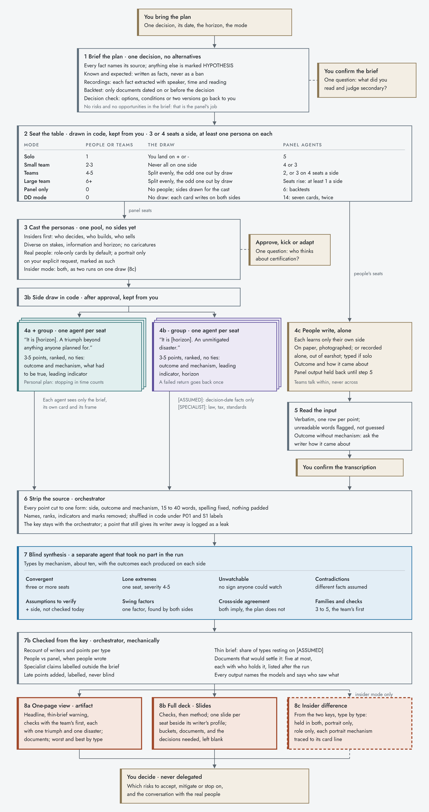

# Pre-mortem

A multi-persona pre-mortem skill for Claude. It runs Gary Klein's pre-mortem around a mixed table: the people in the room write by hand, sealed AI personas take the other seats, and a separate agent reads every point without knowing who wrote it. The output is a one-page view or a deck that ends with the decisions still to be taken, never with a verdict.

Current version: **v0.7.1** (2026-10-24). Draft, used in nine runs; two features not yet tested (see [Limits](#limits)).

## The problem it addresses

A pre-mortem asks a team to assume the plan has already failed, or succeeded beyond anything planned, and to explain why. It works in groups only if the groups stay independent. An early-stage company meets three obstacles:

- **Politics.** As a company scales, decisions move into rooms where hierarchy filters what is said.
- **Capacity.** At twelve people, the founders, the investors and the next hire share one boss, one information base and one story. One team can decently work one outcome; two independent groups do not exist.
- **Confidentiality.** A candidate cannot sit in before the offer; a deal under NDA cannot be opened to the people it will touch.

Sealed synthetic seats answer all three. Each persona is a separate agent that sees the plan, its own card and its frame, never another seat. A small team can split after all, and seats that cannot be filled yet get a voice.

The personas are sealed from each other, not from everything: they share the brief and the model, as a human group shares common knowledge and a company culture. People bring private facts and censor themselves; personas bring no private facts and do not censor themselves. So the table is mixed by rule: every side keeps at least one persona, however many people write.

## How it works

1. **Brief the plan.** One decision, its date, the horizon. Every fact names its source; the rest is marked HYPOTHESIS. The brief lists no risks. Checkpoint: *what did you read and judge secondary?*
2. **Seat the table.** People are drawn onto the triumph or the disaster side in code, and the draw is kept from the user.
3. **Cast the personas** without sides, diverse on stakes, information and horizon. Sides are drawn in code after the cast is approved.
4. **Write, sealed.** One subagent per persona; the people write alone on paper, photographed, or recorded.
5. **Read the input.** Verbatim transcription, confirmed by the user before anything from the panel is shown.
6. **Strip the source.** Every point is cut to one form (outcome and mechanism), shuffled and relabelled in code.
7. **Blind synthesis** by a fresh agent: types by mechanism, then buckets (convergent, lone extremes, unwatchable, swing factors, cross-side agreement and others). The orchestrator rechecks every count from the key and computes how much of the result rests on assumed facts.
8. **Render.** Checks before committing, the team's check first, each with its most extreme triumph and disaster.

The design rules (go to the extremes, every writer alone, split never mirror, people first, blind synthesis, chance drawn in code, team first, the decision never delegated, and others) are at the top of [SKILL.md](pre-mortem/SKILL.md).

| Mode | Who writes |
|---|---|
| Solo | One person and five personas |
| Team | Two to seven or more people or teams, split by draw, at least one persona a side |
| Panel only (`people=0`) | Personas only: backtests, or when the user should not write |
| Insider | The same run twice, role-only cards against the user's portraits of real people, and the difference |
| DD | Inside an acquisition due diligence; a fixed cast of seven writing on both sides |

## Install

Copy the `pre-mortem` folder into your skills directory (for Claude Code, `~/.claude/skills/`), or zip the folder and upload it as a custom skill. Invoke it with `/pre-mortem` or ask for a pre-mortem of a plan.

The surface must offer subagents (without them the panel is not independent, and every output says so), code execution for the draws, and image reading for photographed sheets. The panel and the synthesis run on the middle model tier or above; every output names its models.

## How it was built: a series of experiments

Every version came from a run that changed one variable and was checked against a reference outside the tool: a class's own pre-mortem of the same case, a known outcome, the reaction of a plan's real owner, another model. The cases ranged from a teaching case to backtests on a buy-out and an acquisition, a settled family decision with children as writers, a live municipal building project with its owner writing, and the skill run on itself.

| Version | What changed | Caused by |
|---|---|---|
| v0.3-pre | Go to the extremes; insiders seated first | Run 1, against a class's own pre-mortem of the case |
| v0.3 | Checks first; one triumph and one disaster each; charts removed | Run 2 |
| v0.4 | Team first; factor titles; a cap on types; recount from the key; the real-people rule | Run 3, a backtest |
| v0.4.1 | Invented events marked; specialist claims flagged; the user's traits kept at full strength | Run 3 review |
| v0.4.2 | The brief checkpoint asks what was read and judged secondary | Run 3: the missed factor had been read and left out |
| v0.4.3 | Each seat slide shows its writer's profile beside the points | Run 5c |
| v0.4.4 | No alternatives in a run; the draw kept from the user; panel-only mode | Run 6, a backtest |
| v0.4.5 | Insider mode | Run 7, run 6 with role-only cards |
| v0.5.0 | DD mode | Design; not yet run |
| v0.6.0 | Outcome through mechanism; the decision check; recordings may feed the brief; specialist claims outside the brief; thin-brief share computed; personal plans; one question per checkpoint | Runs 4 to 7 |
| v0.7.0 | Models named in every output, with a floor; role-only cards by default for real people; [ASSUMED] limited to decision-date facts | Run 8, the skill on itself, on three model tiers |
| v0.7.1 | At least one persona on every side, however many people write; teams on one side never compare sheets | The argument for mixed groups |

The full history is in [CHANGELOG.md](CHANGELOG.md). The text of versions v0.2 to v0.4.1 is in [versions/](versions/); the text of v0.4.2 to v0.7.0 was not kept.

**Prompts.** The three templates at the end of SKILL.md (the persona brief, the people's card, the synthesis brief) are the prompts every run fills. The run outputs themselves are not published: most involve real people, real companies or a family.

## Limits

- **Privacy.** People write about real colleagues, investors and family, and that material lands in files. Personas built from real people come close to their real voices. Role-only cards are the default; a portrait only on explicit request, and outputs stay private.
- **Invention that reads as evidence.** Where the brief is silent, personas invent, and can agree on what they invented. Assumed facts are marked [ASSUMED] and counted, but a busy reader reads the marks last. The fix is a fuller brief, not a bigger panel.
- **The brief steers the run.** Every fact put in steers the panel; every fact left out is invisible to it. Backtests also carry the hindsight of whoever writes the brief.
- **One model's blind spots.** A company's blind spots are its own; the model's are the same in every company that runs the skill, and invisible from inside.
- **A substitute for the team.** Used instead of the room, it is a way around the cultural work of a team learning to speak up.
- **Not yet tested:** DD mode, and the v0.7.1 seating with several teams. DD mode is called by a due-diligence skill that is not published here; `/pre-mortem dd` runs it on its own.

## Context

Built in October 2026 for the final paper of the HEC Paris MBA course *Thriving Through Scale-Up*. Claude Opus 5.5 orchestrated every run and its subagents; Claude Sonnet 5.5 and Haiku 5.5 joined in run 8's model round. Tools: Python for the draws and the blind shuffle, a Plaud recorder for spoken input, photographed handwritten sheets.

**Edited for publication.** Three passages in the published text quoted traits a user gave for real people in the backtests. They are replaced by a neutral example or a summary: the trait example in step 3 (v0.7.1 and v0.4.1), the insider-difference example in step 8c (v0.7.1), and one sentence on a real person in v0.4.1.

## Licence

[MIT](LICENSE), Guillaume Simler.
